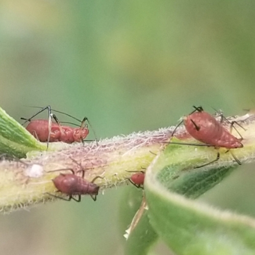

# Instructions

## Français

Commencez par choisir votre langue et supprimez la partie du document rédigée dans l'autre langue.

Répondez aux questions de manière précise mais concise : les questions sont détaillées pour vous guider, c'est pourquoi elles sont nombreuses.
Ne perdez pas votre temps à répéter le cours : vous disposez de tous les documents, il est inutile d'en recopier le contenu.
Pour répondre aux questions factuelles, vous n'avez pas besoin de rédiger des phrases : par exemple, écrivez simplement "4." pour répondre à la question "Combien font 2 + 2 ?".

Avant de commencer:

1.  Tapez votre nom dans l'entête du document, dans le champ "author"
2.  Exécutez dans le terminal:

`quarto publish gh-pages index.qmd`

Pendant votre travail: rendez le document régulièrement (à la fin de chaque question par exemple) pour ne pas laisser les problèmes s'accumuler.

A la fin de l'examen: enregistrez le fichier, faites un commit et poussez le projet sur GitHub.
Ne modifiez pas le projet après la fin de l'examen.

# Français

## Estimation du nombre d'espèces

*Vous disposez de trois inventaires de 10 hectares de forêt (environ 5000 arbres) :*

- *A : 100 espèces dont 20 singletons (*$S_1$), 10 doubletons ($S_2$) et 3 tripletons ($S_3$),
- *B : 80 espèces dont 30 singletons, 20 doubletons et 5 tripletons,*
- *C : 150 espèces dont 110 singletons, 30 doubletons et 10 tripletons.*

Richesse asymptotique de la foret

- Richesse asymptotique Foret A = 120 espèces (La proportion de singleton est de 20% (20/100), on utilise jackknife 1)

- Richesse asymptotique Foret B = 120 espèces (La couverture est de 72,7% (80/110) calculée avec l'estimateur Jackknife 1, on utilise donc Jackknife 2)

- Richesse asymptotique Foret C = 400 espèces (La couverture est de 44,1% en estimant la richesse avce Jakknife 2 (150/340))

*Rappel des formules des estimateurs, avec les notations du cours :*

- $S_{J1} = S_{>0} + S_1$
- $S_{J2} = S_{>0} + 2 S_1 - S_2$
- $S_{J3} = S_{>0} + 3 S_1 - 3 S_2 + S_3$

> Estimez rapidement la richesse asymptotique de la forêt en utilisant les estimateurs jackknife et les règles de @Brose2003.

## Diversité phylogénétique

*La fonction suivante permet de créer un arbre phylogénétique avec 3 espèces. Le paramètre `h` fixe la hauteur à laquelle les espèces A et B se séparent.*

```{r}
tree_3sp <- function(h) {
  NewickABC <- paste0("(C:1,(A:", 1 - h, ",B:", 1 - h, "):", h, ");")
  phyloABC <- ape::read.tree(text = NewickABC)
  plot(phyloABC, direction = "downwards", srt = 90)
  axis(2)
}
# Make a tree
tree_3sp(0.5)
```

> Quelle est la diversité phylogénétique d'ordre 0 (PD de Faith) d'une communauté contenant les trois espèces, dont l'arbre phylogénétique est celui de la figure ?
> 2,5

> Quelle est l'étendue possible des valeurs de `h` ?
> 0 et 1

> Quel est l'effet de `h` sur la valeur de PD ?
> PD décroit de façon linéaire quand h augmente

> Ecrivez la valeur de PD en fonction de \`h\`.
> PD = 3 - h

> Quel est la richesse (taxonomique, pas phylogénétique) de la communauté ?
> Expliquez comment $h$ permet de prendre en compte la proximité entre les espèces B et A.
> S = 3; la parametre h définit la longueur de la
>
> ```{r}
> S = 3 
> #le parametre h  définit la longueur de la branche partagée entre l'espèce A et B. Plus h est grand, plus l'histoire évolutive commune à A et B est longue et plus leurs branches terminales spécifiques sont courtes. Cela permet d'accorder moins de poids à la présence de deux espèces phylogénétiquement très proches qu'à celle de deux espèces ayant divergé tôt pour lesquelles h tandrait verrs 0 et la somme des branches propres vers 2
> ```

> Si les botanistes sont en désaccord sur la synonymie ou non des espèces B et A et qu'une phylogénie montre que leur distance $h$ est faible, proposez une méthode pour les mettre d'accord.
>
> ```{r}
> # fixer un seuil de distance h en se basant sur la distance observée des espèces  bien établies d'un meme genre. Si h est plus grand que le seuil alors les espèces sont synonymes, sinon elles sont distinctes. 
> ```

## Distribution lognormale

*On tire deux distributions aléatoires dans une loi lognormale. Leur taille et leur richesse sont identiques, seul l'écart-type de la distribution varie.*

```{r}
library("tidyverse")
library("divent")
# Set the random seed for reproducibility
set.seed(973)
# Size and richness
the_size <- 1E6
the_richness <- 100
# Draw the first community
rcommunity(
  1, 
  size = the_size, 
  species_number = the_richness, 
  distribution = "lnorm", 
  sd_lnorm = 1
) %>% 
  # Give it a name
  mutate(site = "sigma = 1") %>% 
  # Bind the second community data in the same tibble
  bind_rows(
    # Draw the second community
    rcommunity(
      1, 
      size = the_size, 
      species_number = the_richness, 
      distribution = "lnorm", 
      sd_lnorm = 2
    ) %>% 
      # Give it a name
      mutate(site = "sigma = 2")
  ) -> 
  # Store the result
  comm_lnorm
# Whittaker plot
autoplot(comm_lnorm)
```

> Quelle est la richesse des communautés observées ?
> Quel est l'abondance de l'espèce la plus rare (approximativement, lue sur le graphique) comparativement au nombre d'arbres total ?
>
> ```{r}
> # S = 100 espèces pour chaque communauté
> # Abondance de l'espèce la plus rare, en proportion du total :
> ## sigma = 1 : ~0,06 % (≈ 600 / 1 000 000)
> ## sigma = 2 : ~0,0005 % (≈ 5 / 1 000 000)
> ```

> Qu'observe-t-on pour un échantillon de taille raisonnable, disons 6,25ha avec 600 arbres / ha ?
> Faites la figure.
> Attention à ne pas détruire la variable `comm_lnorm` en réutilisant le code.
>
> \`\`\`{# Taille de l'échantillon : 6.25 ha \* 600 arbres/ha} sample_size \<- 6.25 \* 600
>
> # Abondances de chaque communauté (comm_lnorm n'est pas modifié)
>
> abd_1 \<- comm_lnorm %\>% filter(site == "sigma = 1") %\>% select(starts_with("sp")) %\>% as.numeric() abd_2 \<- comm_lnorm %\>% filter(site == "sigma = 2") %\>% select(starts_with("sp")) %\>% as.numeric()
>
> # Échantillonnage des deux communautés
>
> rcommunity(1, size = sample_size, abd = abd_1) %\>% mutate(site = "sigma = 1") %\>% bind_rows( rcommunity(1, size = sample_size, abd = abd_2) %\>% mutate(site = "sigma = 2") ) -\> comm_sample
>
> autoplot(comm_sample) div_richness(comm_sample, estimator = "naive") \`\`\`

> Tracez le profil de diversité des deux communautés

> Quelle est la communauté la plus diverse ?
> Faites le lien avec la valeur de $\sigma$.
>
> ```{r}
> #La communauté la plus diverse : À l'ordre q = 0, les deux communautés ont la même richesse. Cependant, pour tout ordre q > 0, la communauté sigma = 1 est nettement plus diverse que la communauté sigma = 2. Sigma mesure l'écart-type de la loi log-normale, soit la dispersion de la log-abondance relative des espèces.Un sigma élevé (sigma = 2) implique une forte hétérogénéité d'abondance : quelques espèces très abondantes capturent la majorité des arbres tandis que beaucoup d'espèces sont très rares. Cela correspond à une faible équitabilité (evenness).Un sigma faible (sigma = 1) produit une répartition plus homogène des individus entre les espèces, soit une meilleure équitabilité.Comme les nombres de Hill ^qD (pour q > 0) prennent en compte à la fois la richesse et l'équitabilité (en accordant un poids plus fort aux espèces abondantes à mesure que $q$ augmente), la communauté avec le plus petit sigma$ (sigma = 1) présente la meilleure équitabilité et est donc la plus diverse pour tout q > 0
> ```

## Pielou (1972)

*L'objectif de cette dernière partie est de redécouvrir et de moderniser les résultats de @pielou1972. Les données sont des relevés d'abondances de pucerons du genre* Dactynotus *sur des plantes du genre* Solidago *(Asteraceae), considérées comme leurs habitats possibles. La diversité de chacun des* Solidago *est celle des espèces de pucerons qu'il abrite.*

|                                    |                                    |
|------------------------------------|------------------------------------|
|  |  |

: *Dactynotus pieloui* et *Solidago nemoralis*

### Données

*Nous allons d'abord évaluer la diversité des pucerons dans leurs différents habitats.*

*Les données sont dans le fichier `Pielou1972.csv`.*

```{r}

read_csv("data/Pielou1972.csv") %>% 
  # Replace missing values by zeros
  mutate(across(everything(), ~ replace_na(.x, 0))) %>% 
  # Make an abundances object
  as_abundances() %>% 
  # Set equal weights
  mutate(weight = 1) -> 
  pielou_1972
# Show it
pielou_1972

library(tidyverse)
library(divent)


div_richness(pielou_1972)


div_simpson <- div_hill(pielou_1972, q = 2)
div_simpson

profils <- profile_hill(pielou_1972)
autoplot(profils) 

partition <- div_part(pielou_1972, q = 1)
summary(partition)


```

> Combien y a–t-il d'espèces de pucerons ?
> 12
>  Combien y a–t-il de plantes différentes ?
> 12

*Etant donné le protocole expérimental (toutes les espèces étudiées sont dans les données, il n'y a pas d'espèce non observée), la diversité sera toujours calculée au niveau de l'échantillon: l'argument* `estimator = "naive"` *sera utilisé systématiquement.*

### Diversité des pucerons

> Compter le nombre d'espèces de pucerons sur chaque plante.

> Quelle est la richesse maximale ?

> 17 espèce pour S_juncacea

> Calculer la diversité (pas l'entropie) de Simpson.


> Quelle est la plante la plus diverse au sens de Simpson ?
>S_caesia

> Tracer les profils de diversité de tous les *Solidago*.

> Quelle est la plante apparemment la plus diverse, quel que soit l'ordre de diversité ?

> Vérifiez si les courbes se croisent pour $q>2$.

> Deux profils sont plats.
> Expliquez pourquoi.

> Décomposez la diversité.
> Résumez cette décomposition en une ou quelques phrases.
> Attention : en raison d'un bug dans la version publiée du package divent, vous ne pouvez pas utiliser l'argument `estimator = "naive"` dans la fonction `div_part()`.
> Faites la décomposition de la diversité asymptotique avec l'estimateur par défaut.

### Largeur de niches

*Pour la suite, nous allons suivre Pielou en étudiant la diversité des habitats occupés par chaque espèce de puceron. A partir d'ici, vous ne pouvez plus appliquer simplement le contenu du cours, mais vous devez étendre les notions que vous connaissez à une approche nouvelle.*

*En considérant que chaque* Solidago *constitue un habitat distinct pour une espèce de puceron, le nombre d'habitat occupés est un proxy de la taille de sa niche. Un puceron généraliste occupera plus d'habitats (autrement dit, une niche plus large) qu'un puceron spécialiste. La largeur de niche de chaque espèce de puceron est donc définie dans un premier temps par le nombre d'habitats différents qu'il occupe.*

*Les données doivent être organisées différemment avec les espèces de pucerons en ligne et les habitats en colonnes, ce qui nécessite de passer par une matrice de données et de la transposer. Comme le code est un peu laborieux, il est donné ci-dessous.*

```{r}
# Read the file
read_csv("data/Pielou1972.csv") %>% 
  # Replace missing values by zeros
  mutate(across(everything(), ~ replace_na(.x, 0))) ->
  pielou_raw
# Save the names of the Soledagos
pielou_raw %>% 
  pull(site) ->
  pielou_habitats
# Make a matrix
pielou_raw %>%
  # Remove the site
  select(-site) %>%
  # Make it a matrix
  as.matrix() %>% 
  # Transpose the matrix
  t() ->
  pielou_niches.matrix
# Add the column names
colnames(pielou_niches.matrix) <- pielou_habitats
pielou_niches.matrix %>% 
  # Make an abundances object
  as_abundances() %>%
  # Set equal weights
  mutate(weight = 1) ->
  pielou_niches
# Display it
pielou_niches
```

*Le nombre d'habitats occupés par chaque espèce de puceron peut être compté avec les fonctions de calcul de la diversité habituelles, appliquées à ce jeu de données inhabituel :*

> Quelle est l'espèce de pucerons la plus généraliste ?
> Quelle proportion des habitats occupe-t-elle ?

> Quelle est l'espèce la plus spécialiste ?

> Tracez les profils de diversité des pucerons et faites le lien entre le nombre effectif de *Soledago* et la largeur de niche.

> Pielou s'intéresse seulement à l'entropie de Shannon dans son article, sous une forme archaïque appelée formule de Brillouin, ce qui rend l'article très difficile à lire.
> @Levins1968 avait le premier proposé de mesurer la largeur de niche de cette façon, en proposant deux métriques : $-\sum_i{p_i \log(p_i)}$ et $\sum_i{\frac{1}{p_i^2}}$ où $p_i$ est la probabilité qu'un puceron se trouve dans l'habitat $i$.
> Identifiez ces deux métriques.

### Chevauchement des niches

*Pielou veut évaluer le chevauchement des niches en plus de leur largeur. Le raisonnement est plus clair avec les nombres de Hill. Si les niches ne se chevauchent pas du tout, on trouve une seule espèce par habitat à condition bien sûr qu'il y ait moins d'espèces que d'habitats. A l'inverse, si toutes les espèces sont totalement généralistes, le nombre d'espèces par habitat est celui des espèces.*

> Quelle est la mesure qui rend compte du chevauchement des niches ?
> Donnez sa valeur pour q = 1.
